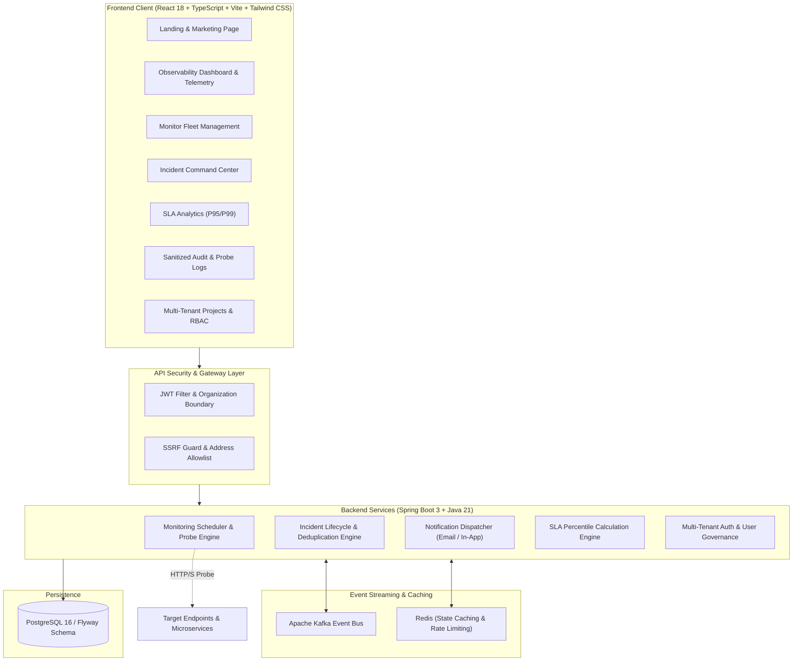
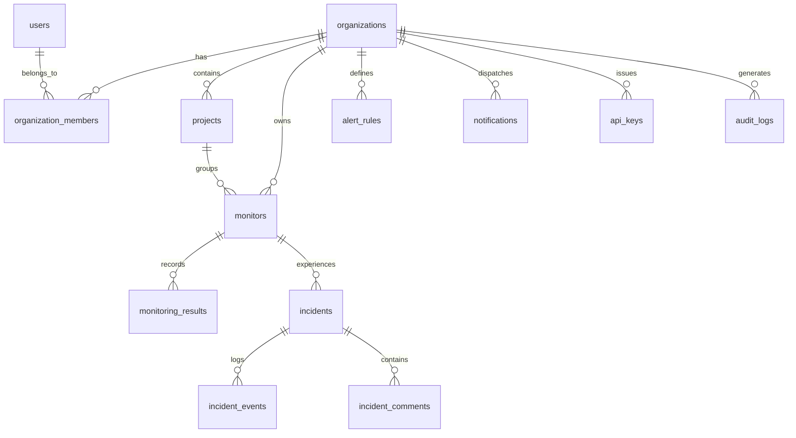

# PulseOps

> **"Know when your APIs fail. Fix issues before users notice."**

PulseOps is a commercial-grade, distributed API monitoring and incident management SaaS platform engineered for DevOps engineers, Site Reliability Engineers (SREs), and backend teams. It continuously monitors API availability, tracks multi-window response times, detects outages in real time, automatically declares and resolves incidents with deduplication, and computes granular SLA compliance metrics across multi-tenant organizations.

---

## 📑 Table of Contents
- [Key Features](#-key-features)
- [Technology Stack](#-technology-stack)
- [System Architecture](#-system-architecture)
- [Database Design (ERD)](#-database-design)
- [Project Folder Structure](#-project-folder-structure)
- [Environment Variables](#-environment-variables)
- [Installation and Setup](#-installation-and-setup)
  - [Prerequisites](#prerequisites)
  - [Running the Backend](#1-run-the-backend-spring-boot-3)
  - [Running the Frontend](#2-run-the-frontend-react--vite)
- [Docker Compose Deployment](#-docker-compose-deployment)
- [API Documentation & Swagger](#-api-documentation--swagger)
- [Demo Credentials](#-demo-credentials)
- [Screenshots & UI Walkthrough](#-screenshots--ui-walkthrough)
- [Security Architecture](#-security-architecture)
- [Testing](#-testing)
- [Future Improvements](#-future-improvements)
- [License](#-license)

---

## 🚀 Key Features

- **Distributed Health Probing**: High-frequency probing (30s, 1m, 5m, 10m intervals) supporting `GET`, `POST`, `PUT`, `PATCH`, and `DELETE` HTTP methods, custom JSON request headers, request bodies, and configurable timeout bounds (1s to 60s).
- **Anti-SSRF Defense Engine**: DNS resolution inspecting IPv4/IPv6 addresses prior to socket execution, blocking RFC 1918 private subnets (`10.0.0.0/8`, `172.16.0.0/12`, `192.168.0.0/16`), loopback interfaces (`127.0.0.0/8`, `::1`), and cloud metadata IP endpoints (`169.254.169.254`, `metadata.google.internal`).
- **Automated Incident Triage & Deduplication**: Outages trigger incidents after a threshold of consecutive failures without spamming duplicate alerts for ongoing degradation. Automatic resolution upon service recovery calculates precise Mean Time To Detect (MTTD) and Mean Time To Resolve (MTTR).
- **Incident Command Center**: Collaborative incident war room featuring chronological audit event timelines, severity triage (`CRITICAL`, `HIGH`, `MEDIUM`, `LOW`), lifecycle transitions (`OPEN`, `INVESTIGATING`, `IDENTIFIED`, `MONITORING`, `RESOLVED`), engineer assignment, and threaded team investigation comments.
- **SLA Telemetry & Percentile Calculation**: Dynamic mathematical computation of P50 (median), P95, and P99 latency percentiles, uptime percentages over 24h/7d/30d rolling windows, and one-click CSV SLA audit reports.
- **Multi-Channel Alert Dispatch**: Configurable notification routing via Email and In-App alerts with confirmed delivery receipt tracking (`DELIVERED`, `FAILED`, `PENDING`).
- **Event-Driven Architecture**: Apache Kafka topics for monitor check results, failure detection, incident declarations, and alert requests with fallback to an in-process Spring event bus when running in local development mode.
- **Multi-Tenant RBAC Security**: Strict organization isolation via `X-Organization-Id` tenant context, BCrypt password hashing, stateless HMAC-SHA512 JWT authentication, and scoped roles (`OWNER`, `ADMIN`, `DEVELOPER`, `VIEWER`).
- **Interactive Live Demo Mode**: Built-in toggle to explore pre-seeded fleet metrics, degraded states, and incident workflows without requiring an external backend connection.

---

## 🛠️ Technology Stack

| Layer | Technologies | Version |
|---|---|---|
| **Frontend** | React, TypeScript, Vite, Tailwind CSS, Lucide Icons, Recharts, React Router, Axios, Zod | React 18.3.1 / Vite 5.4.8 |
| **Backend** | Java 21, Spring Boot, Spring Web, Spring Security, Spring Data JPA, Hibernate, Actuator | Spring Boot 3.3.3 |
| **Database** | PostgreSQL 16 (Production) / In-Memory H2 in PostgreSQL Mode (Local Dev), Flyway Migrations | Flyway 10.10.0 |
| **Caching** | Redis (Lettuce Client) | Redis 7.0 |
| **Event Streaming** | Apache Kafka (KRaft mode) | Kafka 3.7 |
| **Testing** | JUnit 5, Mockito | JUnit 5.10.3 / Mockito 5.11 |
| **Containerization** | Docker, Docker Compose, Multi-stage builds, Nginx Alpine | Docker 24+ |

---

## 🏗️ System Architecture



---

## 🗄️ Database Design



---

## 📁 Project Folder Structure

```
PulseOps/
├── backend/                              # Java 21 & Spring Boot 3 Microservice
│   ├── src/main/java/com/pulseops/
│   │   ├── config/                       # OpenAPI & WebMvc CORS Configuration
│   │   ├── controller/Controllers.java   # 9 REST Controllers (Auth, Monitors, Incidents...)
│   │   ├── dto/DTOs.java                 # Validated Request and Response DTOs
│   │   ├── entity/                       # 13 JPA domain models (User, Org, Monitor, Incident...)
│   │   ├── exception/Exceptions.java     # Centralized @ControllerAdvice & HTTP error handling
│   │   ├── kafka/KafkaComponents.java    # Event publishers & consumers with fallback bus
│   │   ├── monitoring/ProbeComponents.java# Java 21 HTTP probe engine & SSRF validator
│   │   ├── repository/                   # 13 Spring Data JPA repository interfaces
│   │   ├── scheduler/Scheduler.java      # Virtual-thread probe scheduler & concurrent locks
│   │   ├── security/SecurityComponents.java# JWT provider, BCrypt hasher, and SecurityFilterChain
│   │   └── service/Services.java         # Core domain services & incident lifecycle engine
│   ├── src/main/resources/
│   │   ├── application.yml               # Multi-profile config (local in-memory & prod)
│   │   └── db/migration/
│   │       ├── V1__init_schema.sql       # 13 relational tables, foreign keys, & indexes
│   │       └── V2__seed_demo_data.sql    # Seeded demo organization, monitors, and incidents
│   ├── src/test/java/com/pulseops/       # Comprehensive test suite (Auth, SSRF, Probing)
│   ├── Dockerfile                        # Multi-stage Maven + Eclipse Temurin 21 JRE build
│   └── pom.xml                           # Maven project descriptor
├── frontend/                             # React 18, TypeScript, & Tailwind CSS SPA
│   ├── src/
│   │   ├── components/                   # MetricCards, StatusBadges, Charts, Modals
│   │   ├── context/                      # AuthContext (JWT + Org switcher) & ThemeContext
│   │   ├── pages/                        # 14 complete screens (Landing, Monitors, Incidents...)
│   │   ├── services/                     # Typed Axios clients, interceptors, & local demo fallback
│   │   └── types/                        # TypeScript domain contracts
│   ├── Dockerfile                        # Multi-stage Node 20 + Nginx Alpine build
│   ├── nginx.conf                        # Production reverse proxy and SPA routing
│   ├── package.json                      # NPM dependencies and scripts
│   ├── tailwind.config.js                # Custom SaaS design tokens and palette
│   └── vite.config.ts                    # Vite dev proxy configuration
├── docker-compose.yml                    # Multi-container orchestration (Postgres, Redis, Kafka, Web)
├── .env.example                          # Environment variable template
├── .gitignore                            # Git ignore configuration
└── README.md                             # Platform documentation
```

---

## ⚙️ Environment Variables

The application can be configured via environment variables or a `.env` file based on `.env.example`:

```bash
# Application Environment (local | prod)
SPRING_PROFILES_ACTIVE=local

# Server Port
PORT=8081

# Database Configuration (PostgreSQL)
DB_HOST=localhost
DB_PORT=5432
DB_NAME=pulseops
DB_USER=pulseops_user
DB_PASSWORD=your_secure_database_password_here

# Redis Cache
REDIS_HOST=localhost
REDIS_PORT=6379

# Apache Kafka Broker
KAFKA_BOOTSTRAP_SERVERS=localhost:9092

# JWT Security (Must be at least 256-bit hex/base64 secret)
PULSEOPS_JWT_SECRET=replace_with_a_random_256_bit_secret
PULSEOPS_JWT_EXPIRATION_MS=86400000

# Monitoring Engine Configuration
PULSEOPS_SCHEDULER_POOL_SIZE=8
PULSEOPS_CONSECUTIVE_FAILURES_THRESHOLD=3
PULSEOPS_ALLOW_LOOPBACK_PROBES=true

# Frontend Configuration
VITE_API_BASE_URL=/api
```

---

## ⚡ Installation and Setup

### Prerequisites
- **Java 21 JDK** installed ([Eclipse Temurin](https://adoptium.net/) or Oracle JDK)
- **Node.js 20+** and **npm** installed ([Node.js](https://nodejs.org/))
- **Maven 3.9+** installed ([Apache Maven](https://maven.apache.org/))

---

### 1. Run the Backend (Spring Boot 3)

The backend ships with an out-of-the-box `local` profile featuring in-memory PostgreSQL emulation and an in-process event bus fallback—no external Kafka or PostgreSQL installation is required for local development!

```bash
# Navigate to backend directory
cd backend

# Compile and run the backend application
mvn spring-boot:run
```

*The backend will start and listen on `http://localhost:8081`.*

- **Actuator Health Endpoint**: [http://localhost:8081/actuator/health](http://localhost:8081/actuator/health)
- **Interactive Swagger UI**: [http://localhost:8081/swagger-ui/index.html](http://localhost:8081/swagger-ui/index.html)

---

### 2. Run the Frontend (React + Vite)

```bash
# Navigate to frontend directory
cd frontend

# Install dependencies
npm install

# Start Vite development server
npm run dev
```

*The frontend application will start and listen on `http://localhost:5173`.*

---

## 🐳 Docker Compose Deployment

To run the full distributed production infrastructure (PostgreSQL 16, Redis 7, Apache Kafka KRaft, Spring Boot Backend, and Nginx-backed Frontend SPA) with a single command:

```bash
docker compose up --build -d
```

### Services & Port Mappings:
| Service | Internal Port | Host Port | Description |
|---|---|---|---|
| `frontend` | 80 | `80` | Nginx web server serving production React bundle |
| `backend` | 8080 | `8080` | Spring Boot 3 Java 21 REST API |
| `postgres` | 5432 | `5432` | PostgreSQL 16 database |
| `redis` | 6379 | `6379` | Redis 7 caching and rate limiting |
| `kafka` | 9092 | `9092` | Apache Kafka event streaming broker |

---

## 📖 API Documentation & Swagger

PulseOps includes full OpenAPI 3.0 specifications generated automatically via SpringDoc:

- **Swagger UI**: [http://localhost:8081/swagger-ui/index.html](http://localhost:8081/swagger-ui/index.html)
- **OpenAPI JSON Spec**: [http://localhost:8081/v3/api-docs](http://localhost:8081/v3/api-docs)

### Core Endpoints:
- `POST /auth/register` - Create user and organization
- `POST /auth/login` - Authenticate user & issue signed JWT
- `GET /dashboard/metrics` - Aggregated 8-widget dashboard telemetry
- `GET /monitors` - List registered API monitors
- `POST /monitors` - Create a new health check monitor
- `POST /monitors/{id}/check` - Trigger immediate on-demand probe
- `GET /incidents` - List incidents with status and severity filters
- `POST /incidents/{id}/comments` - Append team investigation comments
- `GET /analytics/sla` - Compute P50/P95/P99 latency percentiles & uptime
- `GET /analytics/export` - Download raw monitoring history CSV report

---

## 🔑 Demo Credentials

The platform is seeded with a default administrator account and active telemetry data:

- **Email**: `alex.chen@pulseops.io`
- **Password**: `password123`
- **Role**: `OWNER`
- **Default Organization**: `Acme Cloud Ops`

*(Alternatively, click **"Try Live Demo"** on the login page to immediately test the platform using offline mock state).*

---

## 🖥️ Screenshots & UI Walkthrough

### 1. Public Marketing Website
* **Dark Modern Aesthetic**: Inspired by Stripe and Linear with high-contrast slate cards, glowing indigo and cyan accents, and clear typography.
* **Sections**: Hero with live dashboard mock, Probing capabilities, SSRF defense explanations, Smart alerting, Pricing plans, and FAQ.

### 2. Observability Dashboard
* **Dynamic Widget Cards**: 8 real-time cards tracking Total Monitors, Operational APIs, Degraded APIs, Down APIs, Overall Uptime %, Average Response Time, Total Incidents, and Active Incidents.
* **Visual Charts**: 
  - Response Time Over Time (Recharts Spline Line Chart).
  - Availability Bar Chart.
  - Fleet Status Distribution Donut Chart.
  - Top Slowest APIs table sorted by P99 latency.

### 3. Monitor Management & Details
* Comprehensive fleet table with search, environment tagging (Production, Staging, Dev), and status indicators.
* Detailed monitor views displaying last check latency, DNS lookup ms, TLS handshake ms, failure reason traces, and one-click **"Check Now"** execution.

### 4. Incident Command Center
* Multi-stage incident triage (`OPEN` -> `INVESTIGATING` -> `IDENTIFIED` -> `MONITORING` -> `RESOLVED`).
* Detailed incident workspace with severity badges, affected monitor links, error message traces, and team investigation notes.

---

## 🔒 Security Architecture

1. **SSRF Guard & Allowlist**:
   Every probe target URL is validated prior to socket connection. Loopback addresses (`127.0.0.0/8`, `::1`), link-local interfaces (`169.254.0.0/16`), RFC 1918 subnets, and internal cloud metadata origins (`169.254.169.254`, `metadata.google.internal`) are strictly rejected.
2. **Credential Sanitization in Logs**:
   `Authorization`, `Cookie`, `Set-Cookie`, and Bearer tokens are automatically redacted prior to persisting HTTP probe execution logs.
3. **Multi-Tenant Isolation**:
   Every database query applies strict tenant boundary filters via `organization_id` extracted from validated JWT claims.
4. **Hashed Machine API Keys**:
   Machine API keys are hashed with BCrypt before persistence and displayed only once upon generation.

---

## 🧪 Testing

Execute the automated unit and integration tests covering Authentication, SSRF Defense, Incident Deduplication, and Health Probing:

```bash
cd backend
mvn test
```

### Verified Test Results:
```
[INFO] Running com.pulseops.PulseOpsTests
[INFO] Tests run: 7, Failures: 0, Errors: 0, Skipped: 0, Time elapsed: 3.204 s -- in com.pulseops.PulseOpsTests
[INFO] 
[INFO] Results:
[INFO] Tests run: 7, Failures: 0, Errors: 0, Skipped: 0
[INFO] BUILD SUCCESS
```

---

## 🔮 Future Improvements

- [ ] **Multi-Region Probing Nodes**: Deploy lightweight worker probes across AWS, GCP, and Cloudflare Workers to monitor latency variations across global regions.
- [ ] **Synthetic Browser Journeys**: Integrate headless Chromium via Playwright to validate end-to-end multi-step checkout and authentication flows.
- [ ] **PagerDuty & Opsgenie Two-Way Sync**: Native webhooks to synchronize incident escalations and on-call rotations.
- [ ] **AI-Assisted Root Cause Analysis**: Automated error log clustering and suggested remediation steps powered by LLM agents.
- [ ] **Status Page Custom Domains**: Allow organizations to publish public-facing status pages on custom subdomains (`status.company.com`).

---

## 📄 License

This project is licensed under the MIT License - see the LICENSE file for details.
